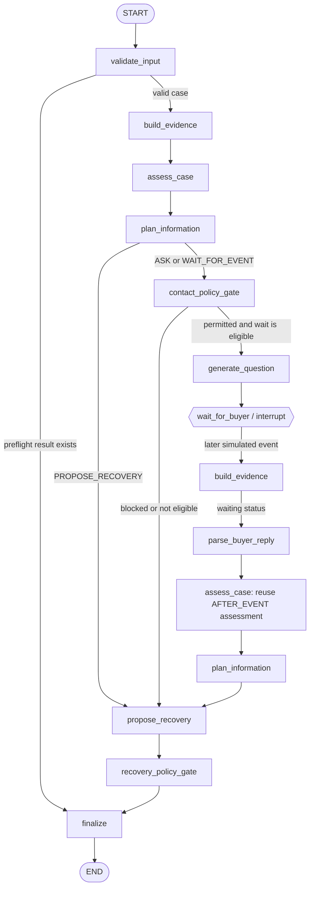

# Order Rescue LangGraph Agent

A small, stateful Python workflow for synthetic failed-delivery cases. LangGraph controls the fixed workflow; an optional DeepSeek reasoner can assess evidence, choose a bounded route, interpret a later event, and propose a candidate action. Deterministic validation and policy gates remain authoritative. The agent never contacts real buyers, dispatches couriers, changes shipment/payment data, issues refunds, or starts returns.

## At a glance

- **Runtime:** Python 3.11+, LangGraph, Pydantic.
- **Default reasoning:** deterministic mock reasoner.
- **Optional model:** DeepSeek, enabled only with `--llm` and `DEEPSEEK_API_KEY`.
- **Model decision points:** one at the initial assessment and one after a simulated event. The post-event assessment is reused; the graph does not make a third decision call.
- **External tools:** none. There are no carrier APIs, real messaging integrations, MCP tools, or execution tools.
- **Execution:** recommendations are illustrative and always have `executed=False`.
- **Local UI:** `ui/index.html` connects to the Python graph through the local LangGraph Agent Server. The React Observatory in the parent project remains a separate mock implementation.

## Architecture



### How a complete run works

1. `validate_input` validates and normalizes one BI case. Invalid, duplicate, stale, PII-marked, or instruction-like inputs can take a deterministic preflight path directly to finalization.
2. `build_evidence` creates the current evidence pack from the case and delivery context. Delayed events and expected labels are kept out of the initial evidence pack.
3. `assess_case` calls `DecisionReasoner.decide(stage=INITIAL)` when a decision-capable reasoner is injected. Otherwise it uses the deterministic mock `assess` interface.
4. `plan_information` maps only registered routes and targets into the existing graph flags. `ASK`, `WAIT_FOR_EVENT`, and `PROPOSE_RECOVERY` are values, never model-supplied node names.
5. Contact-eligible questions pass through `contact_policy_gate`. `generate_question` records a simulated request, then `wait_for_buyer` pauses the graph with a LangGraph interrupt and an in-memory checkpoint.
6. On resume, `build_evidence` first adds the raw event. `parse_buyer_reply` calls `decide(stage=AFTER_EVENT)` once, records its extracted intent/facts, and updates the delivery context. The next `assess_case` reuses that decision's assessment.
7. `propose_recovery` selects a candidate action. `recovery_policy_gate` independently evaluates it. `finalize` publishes only the policy-governed recommendation and sets `executed=False`.

## Nodes: inputs and outputs

The graph nodes read and update a shared `AgentState` (`agent/state.py`). The state is a partial `TypedDict`, so a key may be absent before the node that creates it. Evidence and execution events use reducers: evidence is merged by `evidence_id`, and duplicate event IDs are retained only once.

| Node | Main inputs read from state | State fields written | Responsibility |
| --- | --- | --- | --- |
| `validate_input` | `case_input`, `case_id`, `events` | normalized `case_input`, `input_issues`, `eligibility`, optionally preflight `assessment`, `proposed_action`, `recovery_policy_result`, plus `events` | Runs BI schema validation, eligibility and deterministic preflight checks. Bad or stale cases can be finalized without calling a reasoner. |
| `build_evidence` | `delivery_context`, `case_input`, `case_event` or `buyer_reply`, `iteration` | `evidence`, `events` | Builds normalized evidence for the current iteration. After resume it preserves the raw event/reply before parsing it. |
| `assess_case` | `delivery_context`, `evidence`, optional `case_input`, `llm_decision` | `assessment`, `missing_information`, optional `llm_decision`, `events` | At the initial stage, obtains assessment and route from a decision provider or assessment from the mock reasoner. After an event, reuses the stored LLM assessment instead of making another call. |
| `plan_information` | `assessment`, `llm_decision`, `case_input`, `eligibility`, `questions_asked`, `case_event` | `should_ask_buyer`, `should_wait_event`, `event_target`, `case_status`, `events` | Applies deterministic eligibility and question-limit conditions, then maps an allowed LLM route/target to state flags. |
| `contact_policy_gate` | `case_input` or `delivery_context`, `event_target`, `questions_asked`, `case_event` | `contact_policy_result`, `events` | Calls the deterministic contact policy. It does not send a message. |
| `generate_question` | `assessment`, `llm_decision`, `event_target`, `case_input`, `questions_asked` | `information_request`, temporary `proposed_action`, `questions_asked`, waiting `case_status`, optionally `recovery_policy_result`, `events` | Uses the LLM question when the route is `ASK`; otherwise uses a bounded template. Marks the request as simulated. |
| `wait_for_buyer` | `information_request`, `event_target`, `case_id` | after resume: `case_event` and/or `buyer_reply`, `events` | Raises an interrupt with the question and allowed event types. Resume data is supplied by the caller; nothing contacts a real buyer. |
| `parse_buyer_reply` | raw `case_event` or `buyer_reply`, current `evidence`, `delivery_context`, `case_input`, `iteration` | `case_event`, `buyer_reply`, updated `delivery_context`, optional `llm_decision` and `parsed_facts`, parsed `evidence`, incremented `iteration`, `case_status`, `events` | With a decision provider, extracts event facts and intent at `AFTER_EVENT`; otherwise uses the deterministic event/text parser. Ambiguous intent remains `UNKNOWN`. |
| `propose_recovery` | `assessment`, `llm_decision`, `delivery_context`, `case_input`, `contact_policy_result`, `questions_asked` | `proposed_action`, `events` | Chooses a candidate action. An LLM action is still only a candidate; unresolved information and deterministic precedence rules can replace it. |
| `recovery_policy_gate` | `proposed_action`, `case_input` or `delivery_context`, `assessment`, `case_event` | `recovery_policy_result`, `events` | Evaluates the candidate using deterministic demo-policy rules. |
| `finalize` | `proposed_action`, `recovery_policy_result`, `assessment` | `final_recommendation`, terminal `case_status`, `events` | Resolves the final action from the policy result, records the recommendation, and always sets `executed=False`. |

### Main state contracts

- **Input:** `case_input: BiCaseInput`, `delivery_context: DeliveryContext`, `case_id`, optional trigger metadata. The demo loader initializes evidence, question count, and event fields.
- **Evidence:** `list[Evidence]`, each with `evidence_id`, `kind`, `value`, `provenance`, timestamp, and optional `raw_text`.
- **Assessment:** `Assessment(hypothesis, confidence, missing_information, evidence_refs, summary)`.
- **LLM decision:** `AgentDecision(stage, assessment, route, target, information_request, buyer_intent, parsed_facts, proposed_action, rationale, evidence_refs)`.
- **Route vocabulary:** `ASK`, `WAIT_FOR_EVENT`, `PROPOSE_RECOVERY`. Targets are `BUYER`, `SELLER`, or `OPS`. The after-event decision must use `PROPOSE_RECOVERY`.
- **Policy output:** `PolicyResult(decision, policy_version, rules, triggering_rule_ids)`; decision is `PERMITTED`, `BLOCKED`, or `ESCALATED`.
- **Final output:** `FinalRecommendation(action, policy_decision, policy_version, rationale, executed, side_effects)` and terminal `case_status` (`COMPLETED`, `BLOCKED`, or `ESCALATED`).

## LLM and policy boundary

The `Reasoner` protocol provides `assess(...) -> Assessment`; the `DecisionReasoner` protocol adds `decide(..., stage, case_input, case_event) -> AgentDecision`. `DeepSeekReasoner` implements both so existing assessment callers remain compatible. Its JSON response is validated against Pydantic models and registered enums. Evidence references must belong to the current evidence pack. Invalid responses and transport failures raise a sanitized error; `--llm` does not silently fall back to the mock reasoner.

The LLM may assess, ask, parse, and suggest. Deterministic code owns input validation, evidence assembly, route allowlisting, contact eligibility, question limits, recovery policy, final status, and execution status. The graph has fixed edges; no external action is available to the model.

The BI labels and demo rules (including illustrative R01–R22 checks) are evaluation guidance, not confirmed carrier policy. This is synthetic decision support, not an operational logistics system.

## Data layout

- `data/fixtures/bi_inputs.json`: observable case inputs.
- `data/fixtures/bi_events.json`: delayed synthetic events; loaded only after the flow pauses or when `--auto` is selected.
- `data/expected/bi_expected.json`: expected labels for tests only. It is not imported into the graph or sent to DeepSeek.
- `data/source/README.md`: source and derivation notes. The source workbook is not stored here.
- Workbook fallback/provenance status remains explicit until the versioned workbook is provided.

## Setup and run

Run these commands from this directory:

```sh
python -m venv .venv
source .venv/bin/activate
pip install -r requirements.txt
```

### Local interactive UI

The repository includes a local LangGraph development server configuration. It runs without Docker, serves the graph API and the workbench UI from the same origin, and reads `DEEPSEEK_API_KEY` from this directory's `.env` when present. If this environment already has an older LangGraph CLI/API installed, update it once:

```sh
pip install -U "langgraph-cli[inmem]"
```

```sh
langgraph dev --no-browser
```

Open <http://127.0.0.1:2024/>. Choose a synthetic case, optionally enable DeepSeek, and select **Run agent**. The workbench streams graph updates, shows assessment and policy output, and displays the current evidence and execution history. If the graph interrupts for buyer information, enter a simulated reply in the page to resume that same thread. All runs are local and in-memory; no real messages or courier actions are sent.

If the `langgraph` command is not found after installing requirements, activate the virtual environment again or run its executable directly:

```sh
source .venv/bin/activate
langgraph dev --no-browser
# Or: .venv/bin/langgraph dev --no-browser
```

The workbench uses LangGraph's built-in thread and run APIs. The app also exposes these small custom routes:

| Endpoint | Purpose |
| --- | --- |
| `GET /` | Serve the local workbench UI. |
| `GET /api/cases` | List available synthetic cases without expected labels or delayed events. |
| `GET /api/cases/{case_id}` | Return the initial observable input for one synthetic case. |

The graph API is available at `/docs`. `POST /threads` creates a thread; `POST /threads/{thread_id}/runs/stream` runs or resumes it. The UI sends `config.configurable.reasoning_mode` as `mock` or `deepseek`; a resumed thread uses the selected mode again. LangGraph's local development server provides the checkpoint between the clarification and the reply.

Keep `.env` local. It is ignored by Git and the API never returns its contents.

Default deterministic OR-001 run with a synthetic reply:

```sh
python demo.py --auto
```

Choose a case, supply a simulated reply, or let the CLI prompt you after an interrupt:

```sh
python demo.py --case OR-038 --auto
python demo.py --reply "Vẫn muốn nhận, giao lại giúp mình."
```

Opt in to DeepSeek. The shell does not automatically load `.env`; export the key in the process environment or source a local env file without committing it:

```sh
export DEEPSEEK_API_KEY="your-key"
# Or, if this directory contains a local .env with a shell-compatible assignment:
set -a
source .env
set +a
python -c 'import os; print("loaded" if os.getenv("DEEPSEEK_API_KEY") else "missing")'
python demo.py --llm
python demo.py --auto --llm
```

`python demo.py --llm` runs the initial call and, if the graph asks a question, waits for a **simulated** reply in the terminal. `--auto` uses the synthetic event fixture. `DEEPSEEK_MODEL` optionally overrides the default model. Never put an API key in README, fixtures, source code, or Git.

## Tests and limits

```sh
python -m pytest -q
python -m py_compile agent/*.py demo.py
```

Tests cover the 56 synthetic BI cases, validation, evidence isolation, pause/resume behavior, route and policy boundaries, DeepSeek request/response validation with a fake transport, and CLI output. They do not prove production carrier rules or live model accuracy.

The CLI demo and local UI use in-memory checkpoints, so a restart clears waiting threads. There is no durable database, real buyer messaging, carrier integration, courier dispatch, address/payment modification, refund, or return operation. The parent project's `npm run dev` starts the separate React Observatory mock; it does not start or connect to this Python agent.
