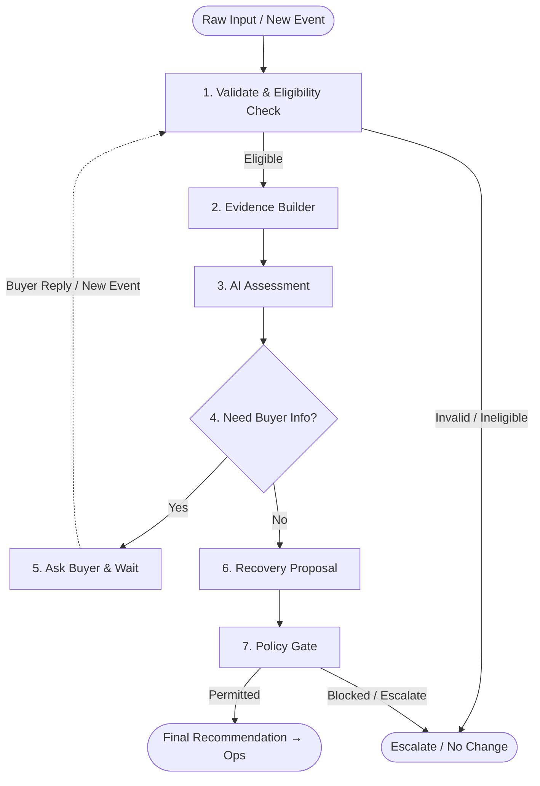

# Order Rescue Agent

A Python LangGraph workflow for **synthetic** failed-delivery cases. DeepSeek assesses eligible cases, while deterministic validation and policy checks decide which recommendation can be shown to Ops. No real buyer message, carrier request, dispatch, address or payment change, refund, or return is executed.

## Flow



The graph uses fixed nodes and edges. `validate_input` runs before every assessment, including after a simulated event. Ineligible, invalid, duplicate, stale, or quarantined cases take the precheck path without an LLM call. `build_evidence` adds currently available source observations; an unrevealed event is absent from the initial evidence pack. `assess_case` calls DeepSeek once for the initial pass and once after each resumed event. The model returns an assessment, a bounded route, and at most a candidate action. The buyer question is simulated through a LangGraph interrupt; a resumed event enters validation again. `recovery_policy_gate` owns the final permission decision. `finalize` always sets `executed=False`.

Only buyer questions can be initiated by the agent. A seller or operational event may be supplied to a waiting synthetic case, but it cannot establish buyer intent. A case waiting for information has no recovery proposal or final policy result yet.

## Run

Python 3.11+ is required. Install dependencies, then set `DEEPSEEK_API_KEY` for an eligible case:

```sh
python -m venv .venv
source .venv/bin/activate
pip install -r requirements.txt
export DEEPSEEK_API_KEY="your-key"
python demo.py --case OR-001
```

`python demo.py --case OR-001 --auto` resumes with the synthetic event fixture. `--reply` supplies a simulated buyer reply. An invalid or ineligible case can finish at precheck without an API key. `DEEPSEEK_MODEL` optionally selects the model; the default is `deepseek-flash`. Never commit keys or put them in fixtures.

For the local UI, run `langgraph dev --no-browser` and open <http://127.0.0.1:2024/>. The server loads a local `.env` when configured. The UI uses DeepSeek for eligible cases and stores waiting threads in the local development checkpoint. The separate root React Observatory is unaffected.

## Data and prompts

- `data/fixtures/bi_inputs.json` contains observable synthetic case inputs.
- `data/fixtures/bi_events.json` contains later synthetic events. Callers reveal them only when resuming a waiting case.
- `data/expected/bi_expected.json` contains evaluation labels and is never imported into agent state or model prompts.
- `agent/prompts.py` contains all model-facing instructions. `agent/reasoning.py` owns the DeepSeek request and response validation.

The versioned BI v0.5 workbook is now available under `scheme_from_bi/`. **The current runtime fixtures and typed input schema still reflect the earlier v0.1 workbook**; migration to the v0.5 seven-input/seventeen-field contract is separate work. See `data/source/README.md` for provenance. Demo rules and thresholds are synthetic, not confirmed carrier policy.

## Verification

```sh
python -m pytest -q
python -m py_compile agent/*.py demo.py
```

Tests inject a controlled decision provider or transport response so they do not call the DeepSeek API. They check graph ordering, event revalidation, LLM request boundaries, policy precedence, and synthetic fixture contracts. They do not establish live-model accuracy or production carrier behavior.
